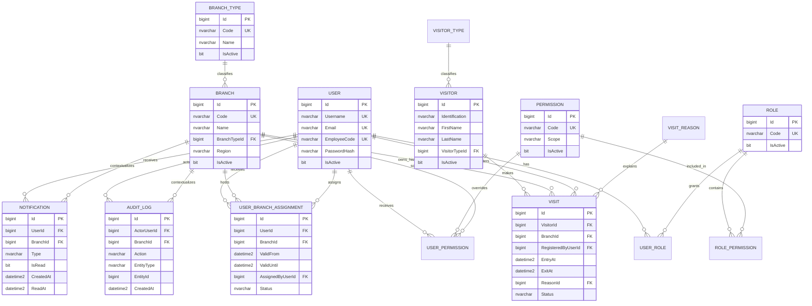

# Diseño del modelo de negocio y base de datos

**Proyecto:** SeNaSa Visits Backend  
**Fase:** 2 - diseño conceptual y lógico  
**Estado:** Documento de diseño; todavía no contiene modelos SQLAlchemy, migraciones, endpoints, login, JWT funcional ni CRUD.

## 1. Objetivo y alcance

El sistema gestionará visitantes y visitas institucionales en múltiples ubicaciones de SeNaSa. Debe conservar el historial de visitas, traslados de colaboradores y auditoría, y debe aplicar la autorización en el backend.

La regla de seguridad principal es:

> Un usuario solo puede operar sobre una sucursal si su rol y sus permisos efectivos lo autorizan. La sucursal enviada por el cliente nunca determina por sí sola el alcance de acceso.

Este documento define el modelo de negocio, los tipos de datos recomendados para SQL Server, relaciones, índices, restricciones y reglas que deberán convertirse en código en una fase posterior.

## 2. Decisiones críticas antes de implementar

### 2.1 La sucursal de una visita es histórica e inmutable

`Visit.BranchId` representa la ubicación física donde se registró la visita. Es obligatorio y no debe cambiar cuando el usuario que registró la visita sea trasladado. El usuario que registra (`RegisteredByUserId`) y la sucursal registrada son hechos históricos independientes.

No se debe resolver la sucursal de una visita consultando la asignación actual del usuario. La consulta de permisos puede usar la asignación vigente del usuario, pero la propiedad de la visita siempre debe venir de `Visit.BranchId`.

### 2.2 Política de roles y alcance

`UserRole` será global: un rol asignado a un usuario no pertenece a una sucursal concreta. El rol concede permisos, pero no concede por sí solo acceso a datos de ninguna sucursal. El alcance operativo se obtiene combinando el permiso efectivo con `UserBranchAssignment`.

La política concreta es:

- **Recepcionista de una sucursal:** normalmente tendrá el rol `RECEPTIONIST`, una única asignación activa y permisos de alcance `BRANCH`. Solo opera sobre esa sucursal.
- **Usuario administrativo de una sucursal:** puede tener un rol administrativo, pero sus operaciones de alcance `BRANCH` siguen limitadas a su asignación activa. Un rol administrativo no es sinónimo de acceso global.
- **Administrador global:** recibe permisos `GLOBAL` explícitos, como `VIEW_GLOBAL_REPORTS` o `MANAGE_BRANCHES`, mediante un rol autorizado o una asignación explícita de usuario. No se crea una sucursal artificial llamada `GLOBAL`.
- **Superadministrador:** es un rol administrativo de máxima confianza definido por permisos globales explícitos. El código del rol no debe convertirse en un bypass oculto de autorización; si se mantiene el código `SUPER_ADMIN`, sus permisos deben estar materializados y auditados.
- **Usuario sin asignación vigente:** no tiene acceso a recursos de sucursal. Solo puede ejecutar una operación global si posee un permiso global explícito y vigente; de lo contrario, se deniega.
- **Usuario trasladado:** se cierra su asignación anterior y se crea la nueva en una transacción. El acceso de sucursal cambia desde el instante efectivo del traslado, pero los datos históricos no se mueven.
- **Usuario que necesita operar en más de una sucursal:** en esta fase no tendrá varias asignaciones activas. Se le concederá un permiso global explícito si la función realmente es global. No se utilizará una sucursal especial como sustituto de un permiso. Si en el futuro se requieren permisos distintos por varias sucursales sin hacerlos globales, deberá aprobarse una extensión explícita del modelo antes de implementarla.

Por tanto, la regla base es que un usuario normal puede tener como máximo una asignación de sucursal activa. `UserRole` sigue siendo global y no se agregará `UserBranchRole` en esta fase. Esto mantiene una única fuente de verdad para el rol y otra para el ámbito físico, y evita que una combinación ambigua de rol y sucursal cree privilegios implícitos.

### 2.3 El alcance se calcula en backend

Cada operación protegida debe construir su alcance a partir de:

1. La identidad autenticada del usuario.
2. Sus roles activos y permisos efectivos.
3. Sus asignaciones vigentes a sucursales.
4. La sucursal de la entidad que se intenta leer o modificar.

Un `branch_id` recibido en una solicitud es solamente un dato que debe validarse contra ese alcance. No puede ampliar permisos. Para evitar filtraciones, las consultas de lectura deben incluir el filtro de sucursal en la consulta a la base de datos, no filtrar únicamente después de traer los datos.

### 2.4 Roles múltiples, permisos por rol y excepciones explícitas

Se recomienda `User -> Roles` mediante una relación muchos a muchos, no una sola columna `RoleId` en `User`. Esto permite combinar responsabilidades institucionales y evita migraciones de esquema cuando aparezca un nuevo rol compuesto.

Los permisos se asignan normalmente a roles mediante `RolePermission`. Se mantiene `UserPermission` para excepciones explícitas, con efecto `ALLOW` o `DENY`, fecha de vigencia y alcance global o limitado a una sucursal. La evaluación debe ser determinista:

1. Se consideran solo reglas activas y vigentes para el usuario, permiso y sucursal solicitados.
2. Una regla `DENY` explícita aplicable siempre prevalece sobre cualquier `ALLOW` explícito o heredado por rol.
3. Si no existe `DENY`, un `ALLOW` explícito aplicable prevalece sobre el resultado de los roles.
4. Si no existe una excepción explícita, se evalúa el permiso heredado por los roles globales del usuario.
5. Si existen varias reglas del mismo efecto, basta una regla válida para ese efecto; sus fechas no se combinan. Una regla global se aplica a todas las sucursales solo si el permiso tiene `Scope = GLOBAL`.
6. `BranchId = NULL` significa alcance global y es inválido para un permiso cuyo `Scope = BRANCH`. Un permiso `GLOBAL` con `BranchId` informado también debe rechazarse como configuración inválida.
7. Para un permiso `BRANCH`, la regla debe referir la sucursal solicitada y el usuario debe tener una asignación vigente a ella. Un `ALLOW` de usuario no puede crear por sí solo una asignación ni reemplazarla.
8. Un permiso `GLOBAL` solo puede concederlo un administrador ya autorizado, debe quedar auditado y no se infiere de `SUPER_ADMIN` sin permisos materializados.
9. Si hay datos inconsistentes, reglas expiradas ambiguas, permisos desconocidos o cualquier conflicto no contemplado, el resultado es denegar.

El permiso efectivo es, por tanto, una función de `(UserId, Permission, BranchId, instante actual)`, no un valor enviado por el cliente. Esta precedencia debe quedar implementada y probada en la capa de autorización.

### 2.5 La asignación vigente no es suficiente para representar el historial

`UserBranchAssignment` conservará todas las asignaciones. La fila vigente tendrá `ValidUntil = NULL`; una transferencia cierra la asignación anterior y crea otra. No se debe actualizar la visita histórica ni moverla de sucursal.

La base de datos debe tener un índice único filtrado para impedir dos filas activas del mismo usuario. Además, las operaciones de alta, cierre y transferencia deben ejecutarse en una transacción con bloqueo apropiado y deben validar solapamientos de intervalos, porque un índice filtrado por sí solo no impide dos intervalos históricos superpuestos.

### 2.6 Desactivación lógica y retención histórica

Las entidades operativas se desactivan con `IsActive` o un estado equivalente. No se recomienda el borrado físico de usuarios, sucursales, visitas, asignaciones ni auditoría. Las foreign keys históricas deben usar `NO ACTION` y las eliminaciones deben rechazarse si existen referencias importantes.

## 3. Convenciones de datos

| Convención | Recomendación |
|---|---|
| Identificadores internos | `BIGINT IDENTITY` como PK; se podrá exponer un identificador opaco en la API si se requiere evitar enumeración. |
| Fechas y horas | `datetime2(3)` en UTC, con nombres `CreatedAt`, `UpdatedAt`, `EntryAt`, `ExitAt`, etc. |
| Fechas de negocio | Usar `datetime2(3)` UTC para asignaciones, con inicio inclusivo y fin exclusivo. |
| Texto | `nvarchar` con longitudes revisadas por negocio; `nvarchar(max)` solo para JSON o notas realmente extensas. |
| Booleanos | `bit`. |
| Códigos | `nvarchar` con índice único cuando sean códigos institucionales. |
| Borrado | `ON DELETE NO ACTION` en referencias históricas; no usar cascadas destructivas. |
| Auditoría de cambios | `UpdatedAt` y, cuando sea necesario, `UpdatedByUserId`. |

SQL Server debe configurarse y operar consistentemente con UTC para la aplicación. La conversión a hora de República Dominicana (`America/Santo_Domingo`) debe hacerse en la presentación o en un servicio explícito, no usando la zona horaria del servidor como fuente de verdad.

### 3.1 Compatibilidad específica con SQL Server

Todas las recomendaciones son compatibles con SQL Server: `BIGINT IDENTITY` puede utilizarse para claves sustitutas, `datetime2(3)` conserva precisión de milisegundos, `nvarchar(max)` admite los JSON redactados de auditoría y las foreign keys pueden declararse con `ON DELETE NO ACTION`. Los índices únicos filtrados son compatibles con SQL Server y se usarán para valores opcionales no nulos y para la asignación activa.

Los `CHECK` deben cubrir reglas de una sola fila, por ejemplo `ValidUntil IS NULL OR ValidUntil > ValidFrom`, estados permitidos, `ExitAt IS NULL OR ExitAt >= EntryAt` y consistencia entre `IsRead` y `ReadAt`. SQL Server no permite que un `CHECK` consulte otra tabla: reglas como `UserPermission.BranchId` frente a `Permission.Scope`, o la prohibición de asignar una sucursal inactiva, deben validarse en la misma transacción de aplicación y reforzarse con procedimientos o triggers solo si se adopta esa política explícitamente.

## 4. Catálogo de ubicaciones

La referencia institucional proporcionada es la página oficial de SeNaSa sobre **centros y puntos de servicio**. Se utilizará como referencia conceptual para el catálogo inicial, pero los datos no se descargan ni se incorporan en esta fase. La consulta automática de la página no estuvo disponible durante este diseño, por lo que no se asumen nombres, códigos ni cantidades concretas.

### 4.1 Branch

Representa cualquier ubicación operativa de SeNaSa que pueda ser propietaria de una visita o ámbito de autorización.

| Campo | Tipo recomendado | Obligatorio | Observaciones |
|---|---|---:|---|
| `Id` | `BIGINT IDENTITY` | Sí | PK. |
| `Code` | `nvarchar(30)` | Sí | Código institucional único y estable. No reutilizarlo. |
| `Name` | `nvarchar(200)` | Sí | Nombre oficial o administrativo. |
| `BranchTypeId` | `BIGINT` | Sí | FK a `BranchType`. |
| `Region` | `nvarchar(100)` | No | Región administrativa; inicialmente puede ser atributo, no entidad independiente. |
| `Address` | `nvarchar(300)` | No | Dirección operativa. |
| `Phone` | `nvarchar(30)` | No | No asumir un único formato telefónico. |
| `IsActive` | `bit` | Sí | Desactivación lógica. |
| `CreatedAt` | `datetime2(3)` | Sí | UTC. |
| `UpdatedAt` | `datetime2(3)` | Sí | UTC. |

`Branch` no debe contener una lista fija de sedes en el código. Agregar una nueva ubicación debe consistir en insertar un registro y su tipo correspondiente.

No se agregará `ParentBranchId` en esta fase. La referencia institucional permite modelar centros y puntos de servicio como ubicaciones del catálogo, pero no confirma una jerarquía administrativa que deba heredarse para autorización. Agregar una relación padre-hijo sin esa definición podría permitir que un permiso sobre una sede se interprete incorrectamente como acceso a todos sus descendientes. Si el negocio confirma una jerarquía, deberá añadirse antes de los modelos como una relación autorreferente `Branch.ParentBranchId` nullable, con `NO ACTION`, prohibición de ciclos, validación de que el padre esté activo y un índice sobre `(ParentBranchId, IsActive)`; la jerarquía no concederá permisos automáticamente.

### 4.2 BranchType

Catálogo configurable para distinguir, como mínimo, `SEDE`, `CENTRO_SERVICIO` y `PUNTO_SERVICIO`. Se propone como entidad adicional porque los tipos son datos institucionales y pueden crecer sin modificar código ni desplegar una nueva versión.

Campos: `Id`, `Code` único, `Name`, `Description` opcional, `IsActive`, `CreatedAt`, `UpdatedAt`.

No se recomienda crear una tabla separada para cada clase de ubicación. La diferencia de comportamiento debe expresarse mediante permisos y configuración, no mediante tablas paralelas.

## 5. Identidad y autorización

### 5.1 User

| Campo | Tipo recomendado | Obligatorio | Observaciones |
|---|---|---:|---|
| `Id` | `BIGINT IDENTITY` | Sí | PK. |
| `Username` | `nvarchar(80)` | Sí | Único; normalizar para comparación case-insensitive. |
| `Email` | `nvarchar(254)` | No | Único cuando esté informado; índice único filtrado `WHERE Email IS NOT NULL`. |
| `FirstName` | `nvarchar(100)` | Sí | Nombre. |
| `LastName` | `nvarchar(100)` | Sí | Apellido. |
| `EmployeeCode` | `nvarchar(50)` | No | Único cuando esté informado; puede ser obligatorio si todo usuario es colaborador. |
| `PasswordHash` | `nvarchar(255)` | Sí cuando exista autenticación local | Nunca almacenar contraseña plana. |
| `IsActive` | `bit` | Sí | Desactivar sin eliminar historial. |
| `CreatedAt` | `datetime2(3)` | Sí | UTC. |
| `UpdatedAt` | `datetime2(3)` | Sí | UTC. |
| `DeactivatedAt` | `datetime2(3)` | No | UTC, si aplica. |

`Username`, `Email` y `EmployeeCode` deben compararse con una política explícita de mayúsculas/minúsculas, preferiblemente una collation case-insensitive para esos campos o normalización controlada antes de persistir. No se deben permitir duplicados lógicos por diferencias de mayúsculas o espacios.

Si en el futuro se integra un proveedor externo de identidad, `PasswordHash` podrá ser nullable para usuarios federados y deberá agregarse un identificador del proveedor. No se debe almacenar información personal adicional sin una necesidad institucional documentada.

### 5.2 Role

Catálogo de roles de autorización.

Campos: `Id`, `Code` único, `Name`, `Description`, `IsActive`, `CreatedAt`, `UpdatedAt`.

Los códigos iniciales pueden ser equivalentes a `SUPER_ADMIN`, `ADMIN`, `RECEPTIONIST` y `USER`, pero deben permanecer como datos administrables. El nombre mostrado no debe usarse como lógica de autorización; las decisiones deben basarse en permisos.

### 5.3 UserRole

Entidad puente global necesaria para la relación muchos a muchos entre usuarios y roles. No tendrá `BranchId`: el rol describe la capacidad institucional del usuario y la asignación a sucursal describe su ámbito físico. Un permiso `BRANCH` de un rol solo se materializa en una sucursal donde exista una asignación vigente.

Campos: `UserId`, `RoleId`, `AssignedByUserId`, `AssignedAt`, `RevokedAt` opcional, `IsActive`, `CreatedAt`, `UpdatedAt`.

La combinación de usuario y rol activo debe ser única. No debe borrarse una asignación histórica de rol si se necesita auditoría; se revoca lógicamente.

### 5.4 Permission

Catálogo de acciones autorizables.

Campos: `Id`, `Code` único, `Name`, `Description`, `Resource`, `Action`, `Scope`, `IsActive`, `CreatedAt`, `UpdatedAt`.

`Scope` debe distinguir al menos `BRANCH` y `GLOBAL`. Un permiso global no debe concederse accidentalmente por tener acceso a una sucursal. Los códigos pueden incluir `VIEW_VISITS`, `CREATE_VISIT`, `UPDATE_VISIT`, `DELETE_VISIT`, `VIEW_VISITORS`, `CREATE_VISITOR`, `UPDATE_VISITOR`, `MANAGE_USERS`, `ASSIGN_USER_BRANCH`, `MOVE_USER_BRANCH`, `VIEW_REPORTS`, `VIEW_GLOBAL_REPORTS`, `VIEW_AUDIT_LOGS` y `MANAGE_BRANCHES`.

### 5.5 RolePermission

Entidad puente entre roles y permisos.

Campos: `RoleId`, `PermissionId`, `AssignedAt`, `AssignedByUserId`, `IsActive`.

La combinación de rol y permiso activo debe ser única. Revocar un permiso debe conservarse como historial cuando la política de auditoría lo requiera.

### 5.6 UserPermission

Se propone porque la regla permite excepciones explícitas por permisos y no todas las excepciones deben convertirse en un rol nuevo.

Campos: `UserId`, `PermissionId`, `BranchId` nullable, `Effect` (`ALLOW`/`DENY`), `ValidFrom`, `ValidUntil` nullable, `AssignedByUserId`, `IsActive`, `CreatedAt`.

Restricciones de `UserPermission`:

- `Effect` solo puede ser `ALLOW` o `DENY`.
- `ValidUntil` debe ser mayor que `ValidFrom` cuando no sea `NULL`; el intervalo también será `[ValidFrom, ValidUntil)`.
- `BranchId = NULL` solo es válido cuando `Permission.Scope = GLOBAL`. Una regla global no se limita a la asignación vigente del usuario, pero requiere un permiso global permitido y una concesión auditada.
- Una regla `BRANCH` debe tener `BranchId` y solo aplica si el usuario tiene una asignación vigente a esa sucursal. La fila no puede ampliar el ámbito físico por sí sola.
- Las reglas activas duplicadas deben evitarse por una restricción o validación de aplicación. Si aun así existen reglas contradictorias, cualquier `DENY` válido gana; entre `ALLOW` válidos basta uno; ante cualquier otra ambigüedad se deniega.
- La desactivación del usuario, permiso o sucursal invalida el resultado efectivo aunque la fila de excepción siga conservada para historial.

## 6. Asignación de usuarios a sucursales

### UserBranchAssignment

| Campo | Tipo recomendado | Obligatorio | Observaciones |
|---|---|---:|---|
| `Id` | `BIGINT IDENTITY` | Sí | PK. |
| `UserId` | `BIGINT` | Sí | FK a `User`. |
| `BranchId` | `BIGINT` | Sí | FK a `Branch`. |
| `ValidFrom` | `datetime2(3)` | Sí | Inicio inclusivo, UTC. |
| `ValidUntil` | `datetime2(3)` | No | Fin exclusivo, UTC; `NULL` significa vigente. |
| `AssignedByUserId` | `BIGINT` | Sí | FK a `User`; quién ejecutó la operación. |
| `Reason` | `nvarchar(500)` | No | Motivo del alta, traslado o cierre. |
| `Status` | `nvarchar(30)` | Sí | `ACTIVE`, `ENDED` o `CANCELLED`; preferiblemente con constraint. |
| `CreatedAt` | `datetime2(3)` | Sí | UTC. |
| `UpdatedAt` | `datetime2(3)` | Sí | UTC. |

Restricciones:

- `ValidUntil > ValidFrom` cuando `ValidUntil` no sea `NULL`.
- `Status = 'ACTIVE'` exige `ValidUntil IS NULL`; `Status IN ('ENDED', 'CANCELLED')` exige una fecha de cierre según la política de transición.
- Como máximo una asignación activa por usuario: índice único filtrado sobre `UserId` donde `ValidUntil IS NULL AND Status = 'ACTIVE'`.
- No permitir intervalos superpuestos para el mismo usuario, incluso si ambos están cerrados. Esta validación requiere transacción, bloqueo de concurrencia y una comprobación de intervalos; no confiar solo en el índice filtrado.
- La comprobación de intervalos debe buscar una fila existente con `Existing.ValidFrom < Candidate.ValidUntil` y `(Existing.ValidUntil IS NULL OR Candidate.ValidFrom < Existing.ValidUntil)`, tratando `NULL` como infinito. No existe solapamiento cuando una fila termina exactamente al comenzar la siguiente.
- `AssignedByUserId` no debe poder ser el mismo usuario salvo una política administrativa explícita.
- No asignar a una sucursal inactiva.
- El traslado debe cerrar la fila anterior y crear la nueva en una sola transacción. Si el nuevo inicio es `2026-09-16`, la fila anterior termina en ese instante y la nueva comienza en el mismo instante.
- Una transferencia no cambia `Visit.BranchId` ni otros hechos históricos.

Para protegerse contra dos transferencias concurrentes, la transacción debe usar aislamiento `SERIALIZABLE` o una combinación equivalente de bloqueo de rango (`UPDLOCK, HOLDLOCK`) sobre un índice que comience por `UserId`. Debe leer y bloquear el historial del usuario, comprobar solapamientos, cerrar la asignación vigente, insertar la nueva y confirmar todo como una sola unidad. El índice único filtrado actúa como segunda barrera para dos filas activas; un conflicto debe provocar rollback y una respuesta de concurrencia, nunca dos asignaciones aceptadas. Reintentos automáticos solo deben ejecutarse si la operación sigue siendo idempotente.

Un usuario sin asignación vigente no debe obtener acceso de sucursal por defecto. Solo un permiso global explícito puede habilitar operaciones globales.

## 7. Visitantes

### 7.1 Visitor

Representa a una persona externa registrada para facilitar visitas futuras. Debe almacenar el mínimo necesario.

| Campo | Tipo recomendado | Obligatorio | Observaciones |
|---|---|---:|---|
| `Id` | `BIGINT IDENTITY` | Sí | PK. |
| `Identification` | `nvarchar(50)` | Sí o condicional | Identificación institucional; definir política para visitantes sin documento. Debe protegerse y limitarse su exposición. |
| `IdentificationNormalized` | `nvarchar(50)` | No | Valor normalizado para búsqueda y unicidad filtrada; no se muestra directamente. |
| `FirstName` | `nvarchar(100)` | Sí | Nombre. |
| `LastName` | `nvarchar(100)` | Sí | Apellido. |
| `Phone` | `nvarchar(30)` | No | Opcional. |
| `Email` | `nvarchar(254)` | No | Opcional; validar formato. |
| `Company` | `nvarchar(200)` | No | Empresa u organización, si aplica. |
| `VisitorTypeId` | `BIGINT` | No | FK a `VisitorType`, si el negocio requiere clasificación. |
| `IsActive` | `bit` | Sí | No borrar visitantes con historial. |
| `CreatedAt` | `datetime2(3)` | Sí | UTC. |
| `UpdatedAt` | `datetime2(3)` | Sí | UTC. |

Política de identificación: cuando el visitante tenga documento, `Identification` será obligatoria, se normalizará (espacios, formato y mayúsculas según la política institucional) y se conservará una representación normalizada protegida para búsqueda. La representación normalizada tendrá un índice único filtrado para evitar dos perfiles con la misma identificación, salvo que el negocio confirme que una identificación puede pertenecer a más de una persona.

Cuando no exista identificación, se permitirá `NULL` y no se intentará deduplicar automáticamente por nombre, teléfono o email. Cada registro sin identificación debe considerarse un perfil no verificado; al registrar una nueva visita se reutilizará solo mediante una selección explícita y autorizada del operador. Si el negocio necesita identificar visitantes sin documento, deberá aprobar un identificador temporal o un mecanismo de verificación antes de implementar modelos.

La búsqueda por identificación usará el valor normalizado y respetará el alcance de la operación. Los datos de identificación y contacto son información personal: no deben aparecer completos en logs, mensajes de error, listados innecesarios ni auditorías; las respuestas deben minimizar y enmascarar esos campos según el permiso.

No se recomienda guardar fecha de nacimiento, fotografía, nacionalidad u otros datos sensibles porque no son necesarios para registrar la visita.

### 7.2 VisitorType

Catálogo opcional pero razonable para clasificar visitantes institucionales sin hardcodear categorías. Solo debe agregarse si la operación realmente necesita filtros, reportes o políticas distintas por tipo. Campos: `Id`, `Code`, `Name`, `Description`, `IsActive`, fechas de auditoría.

## 8. Visitas

### 8.1 Visit

| Campo | Tipo recomendado | Obligatorio | Observaciones |
|---|---|---:|---|
| `Id` | `BIGINT IDENTITY` | Sí | PK. |
| `VisitorId` | `BIGINT` | Sí | FK a `Visitor`. |
| `BranchId` | `BIGINT` | Sí | FK histórica a `Branch`; no nullable ni reasignable. |
| `RegisteredByUserId` | `BIGINT` | Sí | FK a `User`; quién registró la entrada. |
| `EntryAt` | `datetime2(3)` | Sí | UTC. |
| `ExitAt` | `datetime2(3)` | No | UTC; obligatorio al completar. |
| `ReasonId` | `BIGINT` | Sí | FK a `VisitReason` si se requiere catálogo. |
| `Destination` | `nvarchar(200)` | No | Área o destino. |
| `VisitedPerson` | `nvarchar(200)` | No | Persona visitada; podría evolucionar a FK a usuario si el negocio lo exige. |
| `Status` | `nvarchar(30)` | Sí | `ACTIVE`, `COMPLETED`, `CANCELLED`. |
| `Notes` | `nvarchar(1000)` | No | No almacenar secretos ni datos innecesarios. |
| `CreatedAt` | `datetime2(3)` | Sí | UTC. |
| `UpdatedAt` | `datetime2(3)` | Sí | UTC. |
| `CompletedByUserId` | `BIGINT` | No | Quién registró la salida, si fue distinto. |
| `CancelledByUserId` | `BIGINT` | No | Quién canceló, si aplica. |
| `CancelledAt` | `datetime2(3)` | No | UTC. |
| `CancellationReason` | `nvarchar(500)` | No | Requerido cuando se cancela. |

Reglas de estado:

- `ACTIVE`: `ExitAt IS NULL` y la visita está dentro del flujo abierto.
- `COMPLETED`: `ExitAt IS NOT NULL`, `CancelledAt IS NULL`.
- `CANCELLED`: debe existir quién y cuándo canceló; no debe reutilizarse como borrado.
- Una visita completada o cancelada no vuelve a estar activa salvo que exista un caso de corrección administrativo auditado.
- `ExitAt >= EntryAt` cuando exista.
- La salida debe ejecutarse con autorización sobre `Visit.BranchId`, no sobre la sucursal actual del usuario que la creó.
- `BranchId` no debe actualizarse en operaciones ordinarias.

La autorización de cualquier consulta, modificación, checkout o cancelación se evalúa con `Visit.BranchId`. `RegisteredByUserId` solo identifica al usuario que registró el hecho histórico; no determina la sucursal actual, no se usa para redirigir la visita y no se modifica por un traslado. Cualquier corrección excepcional de `BranchId` requeriría una operación administrativa separada, una justificación y una entrada de auditoría; no forma parte del flujo normal.

### 8.2 VisitReason

Se recomienda como catálogo porque los motivos pueden cambiar, requerir reportes y ser administrados institucionalmente. Campos: `Id`, `Code` único, `Name`, `Description`, `IsActive`, fechas. No borrar motivos usados por visitas; desactivarlos.

Para `VisitStatus` no se recomienda inicialmente una tabla independiente: el flujo es pequeño y controlado, por lo que un código con constraint o enum de aplicación es más simple. Si los estados pasan a ser configurables por administradores, podrá evolucionar a catálogo sin cambiar el significado histórico.

## 9. Auditoría

### AuditLog

Debe registrar eventos importantes y ser append-only para usuarios normales. La cuenta de aplicación que inserta auditoría debe tener permiso de `INSERT` y no de `UPDATE` ni `DELETE` sobre esta tabla; los administradores funcionales tampoco deben editarla desde la aplicación. La retención o archivado debe ejecutarse mediante un proceso controlado, separado y auditado.

| Campo | Tipo recomendado | Obligatorio | Observaciones |
|---|---|---:|---|
| `Id` | `BIGINT IDENTITY` | Sí | PK. |
| `ActorUserId` | `BIGINT` | No | FK a `User`; nullable para acciones anónimas o del sistema. |
| `Action` | `nvarchar(60)` | Sí | `LOGIN`, `CREATE_USER`, `MOVE_USER_BRANCH`, etc. |
| `EntityType` | `nvarchar(80)` | Sí | Tipo lógico afectado. |
| `EntityId` | `BIGINT` | No | Nullable para eventos sin entidad concreta. |
| `BranchId` | `BIGINT` | No | Contexto de sucursal cuando aplique; no sustituye a `EntityId`. |
| `OldValues` | `nvarchar(max)` | No | JSON mínimo y redactado. |
| `NewValues` | `nvarchar(max)` | No | JSON mínimo y redactado. |
| `IpAddress` | `varchar(45)` | No | IPv4/IPv6, si está disponible. |
| `UserAgent` | `nvarchar(500)` | No | Opcional y limitado. |
| `CorrelationId` | `nvarchar(100)` | No | Permite seguir una operación distribuida. |
| `CreatedAt` | `datetime2(3)` | Sí | UTC. |

Acciones mínimas: `LOGIN`, `CREATE_USER`, `UPDATE_USER`, `DEACTIVATE_USER`, `ASSIGN_USER_BRANCH`, `MOVE_USER_BRANCH`, `CREATE_VISITOR`, `UPDATE_VISITOR`, `CREATE_VISIT`, `CHECKOUT_VISIT`, `CANCEL_VISIT` y `UPDATE_CONFIGURATION`.

No almacenar en auditoría:

- Contraseñas, hashes, tokens JWT o refresh tokens completos.
- Secretos, claves API o credenciales.
- Datos personales que no sean necesarios para explicar el evento.
- El contenido completo de solicitudes si contiene datos sensibles.

Los valores anteriores y nuevos deben ser una selección de campos relevantes, redactada y limitada. Para cambios de permisos, usuarios o asignaciones se deben incluir los identificadores y efectos necesarios para reconstruir el hecho.

`ActorUserId` debe usar `ON DELETE NO ACTION`. Si un usuario se desactiva, su nombre histórico debe poder resolverse por el registro conservado o mediante una política de snapshot controlada, pero nunca se debe perder la auditoría por borrar el actor.

## 10. Notificaciones

### Notification

La notificación se dirige principalmente a un usuario, por lo que la relación obligatoria es con `User`. La relación con `Branch` es opcional y representa el contexto de la notificación, no su destinatario.

| Campo | Tipo recomendado | Obligatorio | Observaciones |
|---|---|---:|---|
| `Id` | `BIGINT IDENTITY` | Sí | PK. |
| `UserId` | `BIGINT` | Sí | FK a `User`. |
| `BranchId` | `BIGINT` | No | Contexto opcional. |
| `Title` | `nvarchar(200)` | Sí | Título. |
| `Message` | `nvarchar(1000)` | Sí | Mensaje. |
| `Type` | `nvarchar(50)` | Sí | Código de tipo, inicialmente controlado. |
| `IsRead` | `bit` | Sí | Por defecto `0`. |
| `CreatedAt` | `datetime2(3)` | Sí | UTC. |
| `ReadAt` | `datetime2(3)` | No | UTC; obligatorio cuando `IsRead = 1`. |
| `RelatedEntityType` | `nvarchar(80)` | No | Referencia lógica opcional. |
| `RelatedEntityId` | `BIGINT` | No | Referencia lógica opcional. |

No se recomienda una notificación únicamente para una sucursal sin usuario destinatario. Si posteriormente se requieren notificaciones masivas, se puede agregar una entidad de campaña o destinatarios, pero no es necesaria en esta fase.

## 11. Relaciones y comportamiento de eliminación

| Relación | Cardinalidad | FK | Nullability | Eliminación |
|---|---:|---|---|---|
| `BranchType -> Branch` | 1:N | `Branch.BranchTypeId` | No nullable | `NO ACTION`; desactivar tipo, no borrarlo. |
| `User <-> Role` | N:M | `UserRole` | No nullable | Revocación lógica. |
| `Role <-> Permission` | N:M | `RolePermission` | No nullable | Revocación lógica. |
| `User -> UserPermission` | 1:N | `UserPermission.UserId` | No nullable | Conservar historial. |
| `Permission -> UserPermission` | 1:N | `UserPermission.PermissionId` | No nullable | `NO ACTION`. |
| `User -> UserBranchAssignment` | 1:N | `UserId` | No nullable | `NO ACTION`. |
| `Branch -> UserBranchAssignment` | 1:N | `BranchId` | No nullable | `NO ACTION`. |
| `User -> Visit` | 1:N | `RegisteredByUserId` | No nullable | `NO ACTION`; conservar visitas. |
| `Branch -> Visit` | 1:N | `BranchId` | No nullable | `NO ACTION`; conservar historial. |
| `Visitor -> Visit` | 1:N | `VisitorId` | No nullable | `NO ACTION`; desactivar visitante. |
| `VisitReason -> Visit` | 1:N | `ReasonId` | Preferiblemente no nullable | Desactivar motivo, no borrar. |
| `User -> AuditLog` | 1:N | `ActorUserId` | Nullable | `NO ACTION`; permitir evento de sistema. |
| `Branch -> AuditLog` | 1:N | `BranchId` | Nullable | `NO ACTION`. |
| `User -> Notification` | 1:N | `UserId` | No nullable | `NO ACTION` o retención explícita, nunca cascada accidental. |
| `Branch -> Notification` | 1:N | `BranchId` | Nullable | `NO ACTION`. |

No se recomienda `CASCADE DELETE` para entidades históricas. Las relaciones de tablas puente podrían usar cascade solo después de una decisión explícita, pero la opción conservadora es `NO ACTION` y revocación lógica.

Las tablas puente y de historial también tendrán estas foreign keys, todas con `NO ACTION`: `UserRole.AssignedByUserId`, `RolePermission.AssignedByUserId`, `UserPermission.AssignedByUserId`, `UserBranchAssignment.AssignedByUserId`, `Visit.CompletedByUserId` y `Visit.CancelledByUserId` apuntan a `User.Id`. Estas referencias identifican al actor administrativo u operativo y no deben eliminarse en cascada. `Notification.RelatedEntityType` y `RelatedEntityId` son una referencia lógica opcional, no una foreign key polimórfica.

## 12. Aislamiento por sucursal

El modelo debe permitir implementar las siguientes reglas:

- Un recepcionista con asignación vigente a San Francisco puede operar solo sobre visitas cuyo `Visit.BranchId` sea San Francisco.
- No puede consultar visitas de Mao, Santiago, Naco o la Sede salvo permiso explícito de alcance global.
- `RegisteredByUserId` no define por sí solo el acceso actual a una visita; el alcance se valida contra `Visit.BranchId`.
- Un usuario trasladado conserva acceso según sus asignaciones y permisos actuales, pero nunca cambia la sucursal de datos históricos.
- Las operaciones administrativas de asignación y traslado deben requerir `ASSIGN_USER_BRANCH` o `MOVE_USER_BRANCH`, además del alcance necesario sobre la sucursal origen/destino.
- `VIEW_REPORTS` debe limitarse a sucursales autorizadas; `VIEW_GLOBAL_REPORTS` debe ser un permiso separado y explícito.
- Las respuestas de error no deben revelar si existe un registro en otra sucursal cuando el usuario no tiene autorización.
- La API debe evitar confiar en campos de sucursal enviados por el frontend. El backend debe derivar o comprobar la sucursal autorizada y añadir filtros a cada consulta.

Flujo obligatorio para cada operación protegida:

1. El backend obtiene la identidad autenticada, nunca una identidad o rol enviado por React.
2. Calcula los permisos efectivos con la precedencia definida en la sección 2.4.
3. Calcula las sucursales autorizadas mediante las asignaciones vigentes; los permisos globales se evalúan aparte.
4. Determina la sucursal propietaria del recurso desde la base de datos. Para una visita, es `Visit.BranchId`, no `RegisteredByUserId` ni el `branchId` del request.
5. Añade el predicado de sucursal directamente a la consulta SQL antes de leer o modificar datos. Un identificador ajeno debe producir el mismo resultado seguro que un recurso inexistente cuando corresponda.
6. Para crear, el backend deriva la sucursal autorizada y valida el recurso nuevo dentro de la misma transacción; no acepta que el cliente elija una sucursal sin comprobarla.

Ejemplos de intentos indebidos:

- Un recepcionista de San Francisco solicita `GET /visits?branchId=Mao`: se ignora el `branchId` como fuente de autoridad, se aplica el alcance de San Francisco y no se devuelve ninguna visita de Mao.
- El mismo usuario envía `POST /visits` con `BranchId = Santiago`: la operación se rechaza porque Santiago no está en su alcance; no se crea una fila con esa sucursal.
- Un usuario de Mao solicita por identificador una visita de San Francisco: la consulta incluye `Visit.BranchId = Mao`, por lo que no revela ni modifica la visita de San Francisco.
- Un usuario trasladado a Mao intenta cerrar una visita histórica registrada en San Francisco: se autoriza o deniega según sus permisos sobre San Francisco, no según `RegisteredByUserId` ni su sucursal actual; con permisos normales, se deniega.
- Un usuario sin asignación envía `branchId` de cualquier sucursal: no obtiene acceso de sucursal. Solo una autorización global explícita podría permitir una operación global.

Para consultas que involucren varias entidades, el filtro de alcance debe utilizar la sucursal propietaria del recurso protegido. Por ejemplo, para visitas se usa `Visit.BranchId`; para asignaciones se usan `UserBranchAssignment.BranchId`; para auditoría se valida el alcance del evento y el permiso global de logs.

## 13. Índices recomendados

Solo se recomiendan índices que correspondan a búsquedas, unicidad o filtros de autorización frecuentes.

### Unicidad y búsqueda de identidad

- `User(Username)` único.
- `User(Email)` único filtrado cuando no sea `NULL`.
- `User(EmployeeCode)` único filtrado cuando no sea `NULL`.
- `Branch(Code)` único.
- `Role(Code)` y `Permission(Code)` únicos.
- Códigos de catálogos únicos.

### Autorización y asignaciones

- `UserBranchAssignment(UserId, ValidUntil, Status)` para localizar la asignación vigente.
- Índice único filtrado de `UserBranchAssignment(UserId)` donde `ValidUntil IS NULL AND Status = 'ACTIVE'`.
- `UserBranchAssignment(BranchId, ValidFrom, ValidUntil)` para consultas administrativas por sucursal y solapamientos.
- `UserRole(UserId, RoleId)` y `RolePermission(RoleId, PermissionId)` únicos para relaciones activas.
- `UserPermission(UserId, BranchId, PermissionId, ValidFrom, ValidUntil)` para evaluar excepciones, ajustándolo al patrón real de consultas.

### Visitantes y visitas

- `Visitor(IdentificationNormalized)` único filtrado cuando no sea `NULL`; el valor original no debe ser la clave de búsqueda.
- `Visit(BranchId, Status, EntryAt DESC)` para listados operativos por sucursal.
- `Visit(BranchId, EntryAt DESC)` para históricos y reportes por período.
- `Visit(VisitorId, EntryAt DESC)` para historial de un visitante.
- No indexar cada columna de texto de visitante o visita sin un caso de búsqueda real.

### Auditoría y notificaciones

- `AuditLog(CreatedAt DESC)` para retención y consultas temporales.
- `AuditLog(ActorUserId, CreatedAt DESC)` para historial por usuario.
- `AuditLog(EntityType, EntityId, CreatedAt DESC)` para reconstruir cambios de una entidad.
- `AuditLog(BranchId, CreatedAt DESC)` para auditoría acotada por sucursal.
- `Notification(UserId, IsRead, CreatedAt DESC)` para bandeja de notificaciones.

Los índices compuestos deben revisarse con planes de ejecución y cardinalidad real una vez exista carga de producción. La prioridad inicial son los filtros que incluyen `BranchId` y fecha, porque sostienen el aislamiento y los listados de visitas.

## 14. Historial, integridad y retención

- Visitas: nunca borrar físicamente; conservar entrada, salida, cancelación y sucursal original.
- Traslados: cada tramo de asignación es una fila; cerrar y crear en transacción.
- Auditoría: append-only, con controles para impedir edición ordinaria.
- Usuarios, sucursales, roles, permisos y catálogos: desactivar, no borrar si tienen referencias.
- Correcciones administrativas: nuevas acciones auditadas, no sobrescribir silenciosamente el pasado.
- La retención legal y operativa de auditoría y visitas debe definirse con SeNaSa antes de implementar purgas. Cualquier archivado debe preservar identificadores y trazabilidad.

## 15. Fechas y zona horaria

La estrategia recomendada es:

1. La aplicación obtiene la hora actual desde un servicio central y la guarda en UTC.
2. SQL Server usa `datetime2(3)`, no `datetime` ni tipos dependientes de la zona local.
3. Las fechas se serializan en API como ISO 8601 con indicador UTC, por ejemplo `2026-09-15T14:00:00.000Z`.
4. La interfaz convierte a `America/Santo_Domingo` para presentación, sin cambiar el valor persistido.
5. Las asignaciones usan límites inclusivos/exclusivos: `[ValidFrom, ValidUntil)`. Así se permite que una asignación termine exactamente cuando comienza la siguiente.
6. Las fechas de auditoría, creación, actualización, entrada y salida son instantes; no deben interpretarse como fechas locales ambiguas.
7. Si el negocio requiere una fecha de calendario sin hora, debe modelarse explícitamente como `date`, no fingirse como medianoche UTC.

## 16. Diagrama ER conceptual

## 17. Entidades deliberadamente no agregadas

- **Region:** no es necesaria todavía; `Branch.Region` permite iniciar el catálogo sin crear una entidad cuyo ciclo de vida aún no está definido. Se puede normalizar después si hay jerarquías regionales, responsables o reportes propios.
- **BranchHierarchy:** no se agrega en esta fase. No existe confirmación de una jerarquía administrativa de SeNaSa que deba heredarse para autorización. Si el negocio la confirma, se añadirá `ParentBranchId` antes de los modelos, con prohibición de ciclos, `NO ACTION`, validación de padre activo e índice `(ParentBranchId, IsActive)`; la relación no concederá permisos automáticamente.
- **RefreshToken:** no se implementa en esta fase porque no se implementará login. Será necesario solo si se adopta autenticación con refresh tokens persistidos, rotación, revocación y detección de reutilización. No conviene diseñarlo como token plano almacenado.
- **VisitStatus:** se mantiene como estado controlado por constraint mientras el flujo sea fijo. Una entidad separada solo se justifica si los estados son configurables.
- **UserBranchRole:** no se agrega. `UserRole` es global por decisión de diseño; el ámbito se controla con permisos y `UserBranchAssignment`. Un usuario que necesite operar en varias sucursales recibirá un permiso global explícito solo cuando la función lo justifique. No se permite simular acceso global con una sucursal ficticia.

## 18. Decisiones pendientes antes de pasar a código

Antes de crear modelos SQLAlchemy deben confirmarse con el negocio:

1. Si todos los usuarios son colaboradores y, por tanto, `EmployeeCode` es obligatorio.
2. Los tipos y motivos oficiales de visita.
3. La retención legal de visitas, datos personales y auditoría.
4. Si la autenticación será local, federada o híbrida.
5. Si `VisitedPerson` será texto libre o una referencia a usuarios/colaboradores.
6. Si el negocio confirma una jerarquía administrativa de sucursales; mientras tanto no existe `ParentBranchId`.
7. Si el negocio requiere una excepción formal para permisos distintos por varias sucursales sin conceder alcance global; el modelo actual no la permite deliberadamente.

Las políticas de roles globales, una única asignación activa, identificación sin documento, precedencia de permisos, aislamiento por consulta, historial de visitas, fechas UTC y ausencia de cascadas destructivas están decididas en este documento y no deben reinterpretarse durante la implementación.

## 19. Revisión técnica final

### Decisiones confirmadas

- `UserRole` es global; no existe rol implícitamente limitado a una sucursal.
- Un usuario normal tiene como máximo una asignación activa. Un usuario sin asignación no tiene alcance de sucursal.
- No existe una sucursal especial `GLOBAL`. El acceso fuera de la sucursal requiere permisos globales explícitos.
- `UserPermission` se mantiene para excepciones auditables y temporales. La precedencia es `DENY` explícito, luego `ALLOW` explícito, luego permiso de rol; cualquier conflicto o dato inválido termina en denegación.
- Un permiso global requiere `Permission.Scope = GLOBAL` y `BranchId = NULL`; un permiso de sucursal requiere una sucursal concreta y una asignación vigente.
- Cada operación obtiene la identidad en backend, calcula permisos y asignaciones, determina la sucursal real del recurso y aplica el filtro de sucursal dentro de la consulta SQL. El cliente no puede ampliar el alcance con `branchId`.
- No se agrega `ParentBranchId` ahora porque no está confirmada una jerarquía administrativa ni su semántica de autorización.
- Las transferencias usan intervalos `[ValidFrom, ValidUntil)`, un índice único filtrado y una transacción con `SERIALIZABLE` o bloqueos de rango equivalentes para evitar carreras.
- `Visit.BranchId` es obligatorio, histórico e inmutable en operaciones normales. `RegisteredByUserId` no determina el acceso actual ni la sucursal histórica.
- Las identificaciones de visitantes se normalizan y se hacen únicas solo cuando existen; los visitantes sin identificación no se deduplican automáticamente.
- `AuditLog` es append-only para la aplicación y excluye contraseñas, hashes, tokens, secretos y datos personales innecesarios.
- Las foreign keys usan `NO ACTION` para proteger historial; la desactivación lógica es el mecanismo normal.
- Las fechas se almacenan con `datetime2(3)` en UTC, se transportan como ISO 8601 y se presentan en `America/Santo_Domingo`.
- Los índices se concentran en identidad, autorización, `BranchId` con fechas, auditoría, notificaciones y tablas puente; no se mantienen índices opcionales sin una consulta que los justifique.

### Decisiones que siguen dependiendo del negocio

- Obligatoriedad de `EmployeeCode`.
- Catálogos oficiales de tipos y motivos de visita.
- Retención legal de visitas, visitantes y auditoría.
- Proveedor de identidad local, federado o híbrido.
- Si `VisitedPerson` debe ser texto o una referencia a un colaborador.
- Confirmación de una eventual jerarquía administrativa de ubicaciones.
- Necesidad futura de permisos diferentes por varias sucursales sin convertirlos en globales.

### Riesgos residuales

- La autorización no queda garantizada solo por el esquema: requerirá una implementación centralizada, pruebas negativas por sucursal y revisión de cada consulta protegida.
- Las restricciones de intervalos y la transferencia concurrente requieren disciplina transaccional; el índice filtrado por sí solo no resuelve todos los solapamientos históricos.
- La protección de datos de visitantes requiere controles de permisos, enmascaramiento, logs redactados y una política de retención además del modelo.
- Los índices iniciales deben validarse con planes de ejecución y carga real después de implementar los modelos y consultas.
- La cuenta de aplicación y el proceso de auditoría deben recibir permisos SQL Server separados para que `AuditLog` sea realmente append-only.

### Preparación para Fase 3

El modelo está suficientemente definido para pasar a Fase 3 y crear los modelos SQLAlchemy, siempre que las decisiones de negocio pendientes se conviertan en valores concretos antes de generar migraciones o catálogos iniciales. La implementación debe preservar literalmente las reglas confirmadas de autorización, concurrencia, fechas e historial. No se crean modelos ni migraciones como parte de esta revisión.
